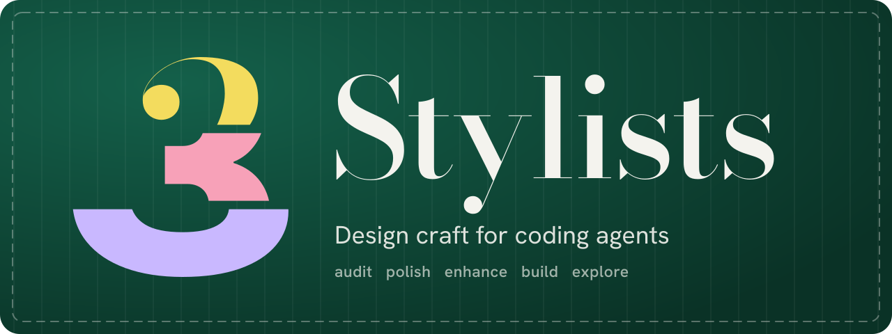
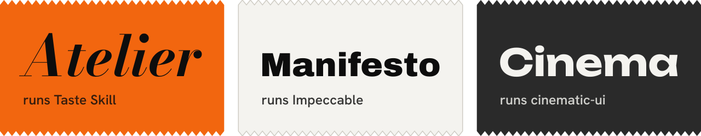

   

3 Stylists is a plugin that makes a coding agent good at the visual side of web work. It audits a site, polishes its details, improves one journey, or builds a new frontend from a brief, and it measures the page in a real browser before and after each change. Arabic and English are both first-class.

When the direction is still open, it builds three independent designs of the same brief so you can choose by looking.

## Install

**Claude Code**

~~~sh
claude plugin marketplace add Mohamad-MG/3-stylists
claude plugin install three-stylists@three-stylists
~~~

Inside a session the same two steps are `/plugin marketplace add Mohamad-MG/3-stylists` and `/plugin install three-stylists@three-stylists`.

**Codex and the ChatGPT desktop app**

~~~sh
codex plugin marketplace add Mohamad-MG/3-stylists
~~~

Then open the plugin browser, `/plugins` in the Codex CLI or the **Plugins** tab in the desktop app, and install **3 Stylists**.

ChatGPT workspaces

A workspace admin imports the repository once: **Admin Console → Plugins → Add → Import marketplace**, with the source `https://github.com/Mohamad-MG/3-stylists` and an empty path. Members then install it from the **Plugins** tab. What a session can reach (code, previews, a browser) depends on the host.

## Use it

Start a new session in your project and name a mode and a target.

In Claude Code:

~~~text
/three-stylists:audit Review the Arabic product pages on a phone and list verified issues
/three-stylists:polish Fix spacing and touch targets on the pricing page
/three-stylists:enhance Improve the quote request flow
/three-stylists:build Build the first page from my brief
/three-stylists:explore Compare three bilingual directions for my brief
~~~

In Codex and ChatGPT, say it in a sentence, or type `@` and pick the plugin or its `three-stylists` skill:

~~~text
Use 3 Stylists to audit the mobile product page. Findings only.
~~~

## Five modes

| Mode | Use it when | You get |
| --- | --- | --- |
| **audit** | You want to know what is wrong before touching anything | Findings with evidence and a repair plan. No edits |
| **polish** | The design is right and the details are not | Small fixes inside the existing design, with before and after evidence |
| **enhance** | One journey or surface underperforms | Scoped changes to that journey, checked by using it |
| **build** | You are starting from a brief | A working first slice in your stack |
| **explore** | You want to see directions before you commit | Three independent Arabic and English variants to pick from |

> [!TIP]
> **An existing project:** start with `audit` on a page you know well, then `polish` or `enhance` what it finds.
> **A new project:** start with `build`, or with `explore` while the direction is still open.

## What it measures

With a browser tool in the session, the standard modes run one bundled script, the probe, on the page at phone and desktop widths, and quote its numbers before and after a change.

| On the page | What the probe reports |
| --- | --- |
| Layout | Horizontal overflow and the element that causes it, fixed bars over content, the space between sections |
| Touch | Tap targets under 44 px, inputs under 16 px |
| Type | The heading outline, how many font sizes and weights the page really uses, web fonts that did not load, letter-spacing on Arabic |
| Surfaces | The radii, shadows and button shapes in use |
| Content | Repeated and truncated text, broken and oversized images |

A readout

Trimmed output from the probe on a test page with planted defects, at 390 px:

~~~json
{
  "page": { "width": 390, "overflowX": 146, "overflowFrom": ["div.wide 16..536"] },
  "copy": { "duplicates": ["2× «The same sentence appears twice on this page, on purpose.»"] },
  "images": { "broken": ["missing.png"], "missingAlt": ["missing.png"] },
  "fixedBars": ["fixed div.bar 390×64 at y780"],
  "gate": { "phone": ["overflow 146px", "tap 24×24 ×", "tap 178×22 email", "input font 14px email"] }
}
~~~

## Arabic and English

Arabic is typeset, not translated. The plugin applies rules for Arabic type, mixed-direction text and the direction of motion, checks that the web font really loaded, and keeps letter-spacing off Arabic. The phone is treated as its own composition, not a narrower desktop.

The rules are in the [Arabic and English reference](skills/three-stylists/references/bilingual.md) and the [phone reference](skills/three-stylists/references/phone.md), with a [catalog of eight tested Arabic faces](skills/three-stylists/references/arabic-type/README.md) and their Latin pairs.

## Explore: one brief, three stylists

Explore runs three third-party design engines, pinned and unmodified, each in its own isolated agent on the same facts. You get three built, bilingual variants side by side.

| Stylist | Engine | How it works |
| --- | --- | --- |
| **Atelier** | [Taste Skill](https://github.com/Leonxlnx/taste-skill) | A production kit for company-grade sites: photo-led pages, the copy written first, a finish gate in the browser |
| **Manifesto** | [Impeccable](https://github.com/pbakaus/impeccable) | A design-direction system that deals visual worlds against the habits of the category, then builds one |
| **Cinema** | [cinematic-ui](https://github.com/akseolabs-seo/cinematic-ui) | A film production for a site: a director, a colour grade, a storyboard and a scroll-driven camera |

Explore needs git, Node.js 22+, Chrome or Chromium, and a host with subagents. The first run fetches the engines into `~/.3stylists/engines`. The other four modes need none of this. See the [Explore workflow](skills/three-stylists/references/explore.md) and the [sources and licences](SOURCES.md).

## Update or remove

~~~sh
claude plugin marketplace update three-stylists
claude plugin update three-stylists@three-stylists
claude plugin uninstall three-stylists@three-stylists

codex plugin marketplace upgrade three-stylists
codex plugin marketplace remove three-stylists
~~~

## Develop

~~~sh
node --test                        # package checks
node scripts/sync-manifests.mjs    # after editing plugin.json
claude plugin validate .
~~~

Read the [architecture](ARCHITECTURE.md) before changing the package and the [changelog](CHANGELOG.md) for what shipped. 3 Stylists is released under the [MIT licence](LICENSE).
