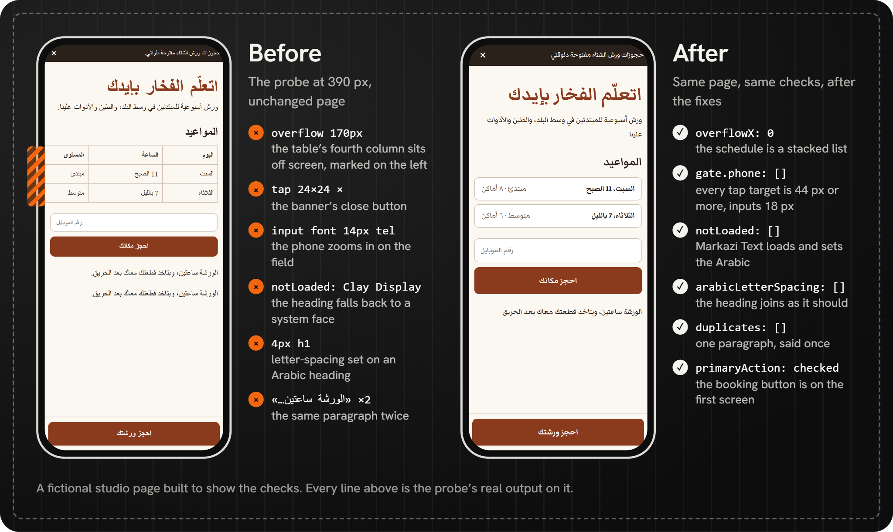
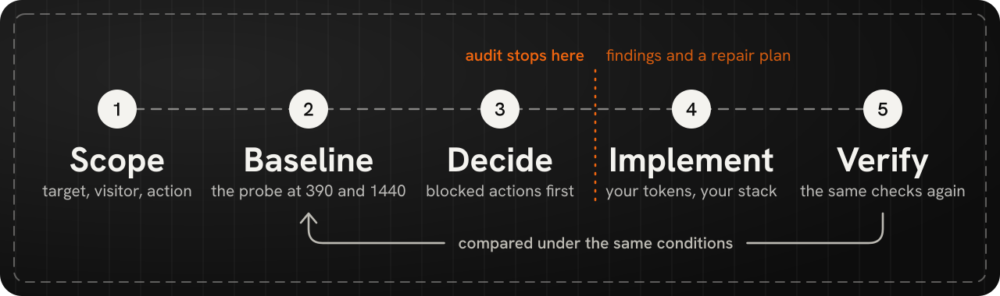
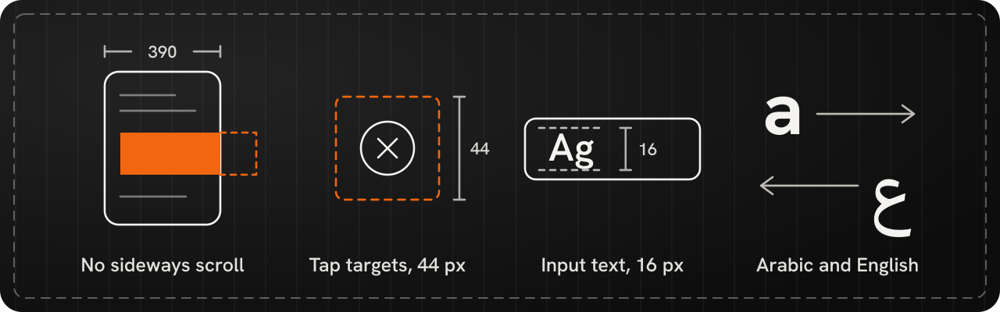

  

  <b>A plugin that gives your coding agent a designer's eye.</b> 
  It measures a page in a real browser, fixes what the numbers show, and measures again. 
  Arabic and English are both first-class.

  
  
  

  <a href="#install">Install</a> &nbsp;·&nbsp;
  <a href="#use-it">Use it</a> &nbsp;·&nbsp;
  <a href="#five-modes">Modes</a> &nbsp;·&nbsp;
  <a href="#what-it-measures">What it measures</a> &nbsp;·&nbsp;
  <a href="#explore-one-brief-three-directions">Explore</a> &nbsp;·&nbsp;
  <a href="#questions">Questions</a>

 

Coding agents write working interfaces that still look unfinished: text that runs off a phone screen, buttons too small to tap, three shades of the same grey, Arabic set like a translation. Altero teaches the agent to see these, prove them with numbers, and fix them inside your own design and stack.

Point it at a project you already have, or at a brief for one you are starting.

The name comes from tailoring. An alteration keeps the garment yours and makes it fit, and that is the job here too: your design, measured and taken in where it pulls.

## See it work

Every finding comes with the measurement behind it, and every fix is checked with the same measurement, at the same width, in the same state.

### What a pass can look like

Seven fictional brands, one after another. The first three are **polish**, which keeps the design and fixes what breaks it, and two of them are right-to-left Arabic pages. The fourth is **enhance**, which reworks a single journey from product to bag. The last three are **explore**, which proposes a new direction for the same brief.

These are illustrations made for this README, not output from the plugin. The measured example above is real.

## Install

**Claude Code**

~~~sh
claude plugin marketplace add Mohamad-MG/altero
claude plugin install altero@altero
~~~

Inside a session the same two steps are `/plugin marketplace add Mohamad-MG/altero` and `/plugin install altero@altero`.

**Codex and the ChatGPT desktop app**

~~~sh
codex plugin marketplace add Mohamad-MG/altero
~~~

Then open the plugin browser, `/plugins` in the Codex CLI or the **Plugins** tab in the desktop app, and install **Altero**.

<b>ChatGPT workspaces</b>

 

A workspace admin imports the repository once: **Admin Console → Plugins → Add → Import marketplace**, with the source `https://github.com/Mohamad-MG/altero` and an empty path. Members then install it from the **Plugins** tab. What a session can reach (code, previews, a browser) depends on the host.

## Use it

Start a new session in your project and name a mode and a target.

~~~text
/altero:audit Review the Arabic product pages on a phone and list verified issues
/altero:polish Fix spacing and touch targets on the pricing page
/altero:enhance Improve the quote request flow
/altero:build Build the first page from my brief
/altero:explore Compare three bilingual directions for my brief
~~~

In Codex and ChatGPT there are no slash commands. Say it in a sentence, or type `@` and pick the plugin:

~~~text
Use Altero to audit the mobile product page. Findings only.
~~~

## Five modes

| Mode | Use it when | You get |
| --- | --- | --- |
| **audit** | You want to know what is wrong before touching anything | Findings with evidence and a repair plan. No edits |
| **polish** | The design is right and the details are not | Small fixes inside the existing design, with before and after evidence |
| **enhance** | One journey or surface underperforms | Scoped changes to that journey, checked by using it |
| **build** | You are starting from a brief | A working first slice in your stack |
| **explore** | You want to see directions before you commit | Three independent Arabic and English variants to pick from |

> [!TIP]
> **An existing project:** start with `audit` on a page you know well, then `polish` or `enhance` what it finds.
>
> **A new project:** start with `build`, or with `explore` while the direction is still open.

### How a mode runs

The four standard modes share one workflow. They keep your brand, your components and your content sources, leave navigation, analytics and business logic alone, and report what was verified, what failed and what could not be checked.

## What it measures

With a browser tool in the session, the agent runs one bundled script, the probe, at phone and desktop widths. It returns facts, not opinions.

| Area | What the probe reports |
| --- | --- |
| **Layout** | Horizontal overflow and the element that causes it, fixed bars over content, the space between sections |
| **Touch** | Tap targets under 44 px, inputs under 16 px, whether the main action is on the first screen |
| **Type** | The heading outline, how many font sizes and weights the page really uses, web fonts that did not load, letter-spacing and tight leading on Arabic |
| **Surfaces** | The radii, shadows and button shapes in use |
| **Content** | Repeated and truncated text, broken and oversized images, full stops in interface text |

<b>A raw readout</b>

 

The probe's output on the "before" page above, trimmed:

~~~json
{
  "page": { "width": 390, "overflowX": 170, "overflowFrom": ["table -170..370"] },
  "type": {
    "notLoaded": ["Clay Display"],
    "arabicLetterSpacing": ["4px h1 «اتعلّم الفخار بإيدك»"],
    "tightArabicLeading": ["1.05 h1 «اتعلّم الفخار بإيدك»"]
  },
  "copy": { "duplicates": ["2× «الورشة ساعتين، وبتاخد قطعتك معاك بعد الحريق.»"] },
  "gate": {
    "phone": ["overflow 170px", "tap 24×24 ×", "tap 350×38 tel", "tap 350×42 احجز مكانك", "input font 14px tel"],
    "primaryAction": "checked: احجز مكانك"
  }
}
~~~

## Arabic and English

Most tools treat Arabic as English flipped right to left. Altero sets it as its own script:

- **Type:** no letter-spacing, since it breaks the joins between letters, no synthetic bold or italic, and line height raised until nothing clips
- **Direction:** logical properties throughout, Latin names and numbers isolated inside Arabic, direction-carrying icons mirrored and logos left alone
- **Motion:** "forward" follows the reading direction, and Arabic is never split into characters for an animation
- **Phone:** the phone is its own composition, not a narrower desktop

The rules are in the [Arabic and English reference](skills/altero/references/bilingual.md) and the [phone reference](skills/altero/references/phone.md), with a [catalog of eight tested Arabic faces](skills/altero/references/arabic-type/README.md) and their Latin pairs.

## Explore: one brief, three directions

Explore starts from your real page, not from a blank one. It takes a light copy of your front end, asks five questions, and then three third-party design engines, each pinned to an exact commit and unmodified, rebuild that page in three directions, each in its own isolated agent. You compare them with your current site in one showcase, and you apply the one you pick.

1. **A light copy.** One command saves the rendered page and the files it loads, at phone and desktop width, front end only. Your repository, backend, database and secrets are never touched, and nothing is asked of them.
2. **Five questions, all closed.** How the page should feel, how far the colours may move, how much goes on each screen, how much it moves, and how far to go from the current page. Each is a pick of two or three, and "you choose" is always allowed. They never ask about your business, your call to action or your photos: Altero reads those from the page.
3. **Three directions.** A short preview says what each stylist will do for your visitor and what it will not do, then they build in parallel. The showcase opens at once with your current site, and each direction appears as it lands.
4. **One applied.** You take one direction and Altero carries it into your real project, then measures the page again against the copy.

| Stylist | Engine | How it works |
| --- | --- | --- |
| **Atelier** | [Taste Skill](https://github.com/Leonxlnx/taste-skill) | A production kit for company-grade sites: photo-led pages, the copy written first, a finish gate in the browser |
| **Manifesto** | [Impeccable](https://github.com/pbakaus/impeccable) | A design-direction system that deals visual worlds against the habits of the category, then builds one |
| **Cinema** | [cinematic-ui](https://github.com/akseolabs-seo/cinematic-ui) | A film production for a site: a director, a colour grade, a storyboard and a scroll-driven camera |

Explore needs git, Node.js 22+, Chrome or Chromium with Playwright, and a host with subagents. The first run fetches the engines into `~/.altero/engines`. The other four modes need none of this. Read the [Explore workflow](skills/altero/references/explore.md) and the [sources and licences](SOURCES.md).

## Questions

<b>Will it redesign my site?</b>

 

Only if you ask for `build` or `explore`. `audit` makes no edits, `polish` works inside the existing design, and `enhance` changes the one journey you name.

<b>Does it need a browser?</b>

 

No, but it is better with one. Without a browser tool it works from your source files and screenshots, and labels anything it could not check in a browser as unverified.

<b>Which stacks does it support?</b>

 

Any. It works in your project's own stack, tokens and components. Nothing is added to your dependencies for the four standard modes.

<b>Does it send my code anywhere?</b>

 

The plugin itself has no server. It runs inside your agent, under whatever access your host already has. Only Explore downloads anything: the pinned engines from GitHub, cached in `~/.altero/`. Explore runs are written to `.altero/runs/` in your project.

<b>My site is English only. Is it still useful?</b>

 

Yes. The Arabic rules apply only to Arabic and right-to-left pages. Everything else, the probe, the phone layer and the workflow, applies to any page.

## Update or remove

~~~sh
claude plugin marketplace update altero
claude plugin update altero@altero
claude plugin uninstall altero@altero

codex plugin marketplace upgrade altero
codex plugin marketplace remove altero
~~~

## Develop

~~~sh
node --test                        # package checks
node scripts/sync-manifests.mjs    # after editing plugin.json
claude plugin validate .
~~~

Read the [architecture](ARCHITECTURE.md) before changing the package and the [changelog](CHANGELOG.md) for what shipped.

 

MIT licensed. The engines Explore runs keep their own licences, listed in <a href="SOURCES.md">SOURCES.md</a>.

